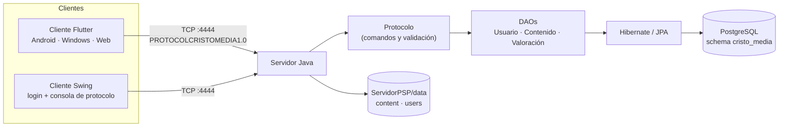
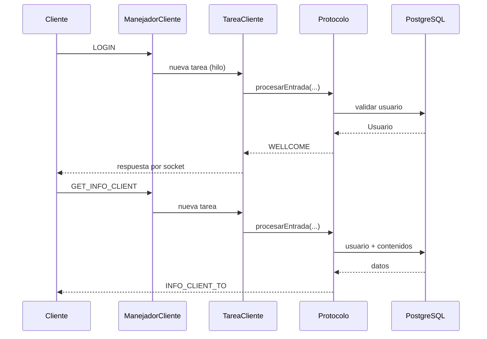
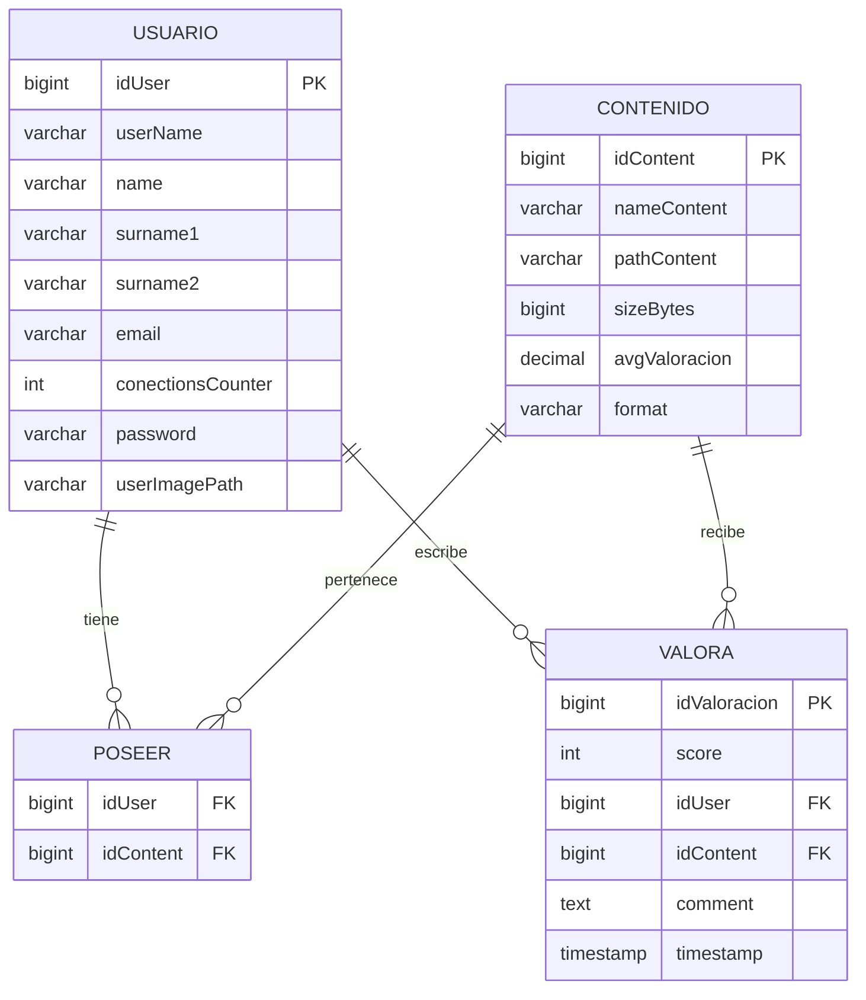

# CristoMedia

**Cliente-servidor de contenidos multimedia con protocolo propio, sockets TCP, PostgreSQL y clientes Swing + Flutter.**

[](https://openjdk.org/)
[](https://flutter.dev/)
[](https://www.postgresql.org/)
[](https://hibernate.org/)
[](#contexto-educativo)

> **Proyecto educativo.** Desarrollado como práctica final de la unidad de
> comunicaciones en red de **Programación de Servicios y Procesos (PSP)**, en
> 2.º curso del **CFGS Desarrollo de Aplicaciones Multiplataforma** del
> **CES Cristo Rey** (curso 2025/2026). Se publica como muestra de aprendizaje;
> no es un producto comercial ni está pensado para producción.

---

## Índice

- [Contexto educativo](#contexto-educativo)
- [Qué hace](#qué-hace)
- [Arquitectura](#arquitectura)
- [Tecnologías](#tecnologías)
- [Estructura del repositorio](#estructura-del-repositorio)
- [El protocolo `PROTOCOLCRISTOMEDIA1.0`](#el-protocolo-protocolcristomedia10)
- [Base de datos](#base-de-datos)
- [Puesta en marcha](#puesta-en-marcha)
- [Cómo probarlo](#cómo-probarlo)
- [Decisiones de diseño](#decisiones-de-diseño)
- [Qué he aprendido](#qué-he-aprendido)
- [Limitaciones y siguientes pasos](#limitaciones-y-siguientes-pasos)
- [Autoría](#autoría)

---

## Contexto educativo

Este proyecto nació como entrega final de la asignatura **Programación de
Servicios y Procesos (PSP)** del ciclo **DAM**. El objetivo era construir una
aplicación cliente-servidor completa que ejercitara, en un solo proyecto, los
contenidos del módulo:

- Comunicación en red mediante **sockets TCP**.
- Diseño e implementación de un **protocolo de aplicación** propio.
- **Concurrencia**: varios clientes, varios hilos por cliente y acceso seguro a
  recursos compartidos.
- Persistencia con **JPA/Hibernate** y **PostgreSQL**.
- Separación de responsabilidades: servidor, protocolo, DAO, modelo y clientes.
- Interfaces de usuario en **Swing** y **Flutter**.

El repositorio original era privado y pertenecía a la organización del centro.
Esta copia se publica con fines de portfolio: se han eliminado artefactos de
compilación, fotos y documentos personales, y se han sustituido los datos
reales por datos ficticios de demostración.

---

## Qué hace

CristoMedia es una pequeña plataforma de contenidos (imágenes, vídeos y PDF)
con las siguientes funcionalidades:

- **Autenticación** de usuarios con usuario y contraseña.
- **Token de sesión** generado en el servidor y validado en cada petición.
- **Límite de 3 conexiones simultáneas** por usuario.
- **Catálogo de contenidos**: el cliente recibe todos los contenidos del
  sistema y los que posee el usuario.
- **Búsqueda** de contenidos por nombre.
- **Ficha de contenido**: metadatos, propietarios, reseñas y nota media.
- **Reseñas** con puntuación de 0 a 5 y comentario.
- **Recálculo de la media** y **broadcast** de la nueva reseña a todos los
  clientes conectados.
- **Streaming de archivos** por el mismo socket, en paquetes de 1024 bytes
  codificados en Base64.
- **Fotos de perfil**: descarga de la foto propia y de otros usuarios.
- **Monitor del servidor** en Swing con log, contador de clientes y modo debug.
- **Cliente Flutter** responsive (móvil/escritorio) con consola de protocolo.

---

## Arquitectura



### Flujo de una petición



### Modelo de concurrencia

- El servidor abre un `ServerSocket` en el puerto **4444**.
- Cada cliente aceptado se atiende en su propio **hilo** (`ManejadorCliente`).
- Cada línea recibida se procesa en un **hilo de tarea** (`TareaCliente`), lo
  que permite atender peticiones lentas (por ejemplo, el streaming de un
  archivo) sin bloquear la lectura del socket.
- Las respuestas se escriben con un `ReentrantLock` por cliente para evitar que
  dos hilos mezclen mensajes en el mismo `PrintWriter`.
- El estado de sesión (usuario y token) vive en el `ManejadorCliente`.
- El protocolo se comparte entre clientes; los DAO no guardan estado y cada
  operación abre su propio `EntityManager`.

---

## Tecnologías

| Capa | Tecnología |
|---|---|
| Servidor | Java 17+, sockets TCP, hilos, `ReentrantLock` |
| Persistencia | JPA 3.1, Hibernate 6.4, PostgreSQL |
| Cliente de escritorio | Java Swing |
| Cliente multiplataforma | Flutter / Dart, `provider`, `path_provider` |
| Construcción | Gradle 8.14 (wrapper incluido) |
| Datos de prueba | SQL (`create_dbSQL.sql`, `instanciacion.sql`) |

---

## Estructura del repositorio

```text
cristomedia/
├── ServidorPSP/
│   ├── build.gradle                 # Build del servidor y del cliente Swing
│   ├── settings.gradle
│   ├── gradlew / gradlew.bat        # Wrapper de Gradle
│   ├── data/
│   │   ├── content/                 # Archivos servidos por streaming
│   │   └── users/                   # Fotos de perfil
│   └── src/main/
│       ├── java/
│       │   ├── server/              # Servidor, ManejadorCliente, TareaCliente
│       │   ├── client/              # Cliente Swing (login + consola)
│       │   ├── common/              # Protocolo, TokenGenerator, ILogger
│       │   ├── controlador/         # DAOs (Usuario, Contenido, Valoración)
│       │   └── modelo/              # Entidades JPA + scripts SQL
│       └── resources/META-INF/
│           └── persistence.xml      # Configuración de JPA/PostgreSQL
├── vistalogin/                      # Cliente Flutter
│   ├── lib/
│   │   ├── main.dart                # Login
│   │   ├── home_screen.dart         # Perfil, catálogo y búsqueda
│   │   ├── content_detail_screen.dart
│   │   ├── socket_service.dart      # Conexión TCP y estado
│   │   ├── protocolo.dart           # Construcción/parseo de tramas
│   │   ├── models/                  # Usuario, contenido, reseña...
│   │   └── widgets/LogConsole.dart  # Consola de depuración
│   └── test/widget_test.dart        # Test de renderizado del login
└── README.md
```

---

## El protocolo `PROTOCOLCRISTOMEDIA1.0`

El protocolo es **texto plano, orientado a líneas** y usa `#` como separador de
campos. Cada mensaje termina en `\n`. El primer campo es siempre la cabecera
`PROTOCOLCRISTOMEDIA1.0`; el segundo, la marca de tiempo; el tercero, el comando.

```text
PROTOCOLCRISTOMEDIA1.0#<timestamp>#<COMANDO>#<args...>
```

### Comandos principales

| Comando | Dirección | Descripción |
|---|---|---|
| `LOGIN#user#pass` | Cliente → Servidor | Inicia sesión. Devuelve `WELLCOME#user#WITH_TOKEN#token#`. |
| `GET_INFO_CLIENT#user#WITH_TOKEN#token` | Cliente → Servidor | Devuelve datos del usuario, catálogo y contenidos poseídos. |
| `GET_INFO_CONTENT_ID#id#BY#user#WITH_TOKEN#token` | Cliente → Servidor | Devuelve metadatos, propietarios y reseñas de un contenido. |
| `OK_INFO_CONTENT_RECEIVED#...#NOW_READY_TO_RECEIVE_CONTENT_STREAM` | Cliente → Servidor | Pide el archivo del contenido. |
| `NEW_REVIEW_FOR#id#BY#user#WITH_TOKEN#token#REVIEW_TEXT#texto#SCORING#n` | Cliente → Servidor | Añade una reseña (0–5) y hace broadcast. |
| `GET_USER_PHOTO#user#WITH_TOKEN#token` | Cliente → Servidor | Pide la foto propia. |
| `GET_USER_PHOTO#target#BY#user#WITH_TOKEN#token` | Cliente → Servidor | Pide la foto de otro usuario. |
| `READY_TO_RECEIVE_IMAGE_FOR#target#...` | Cliente → Servidor | Confirma que está listo para recibir la imagen. |
| `BYEBYE#user#WITH_TOKEN#token` | Cliente → Servidor | Cierra la sesión de forma ordenada. |

### Respuestas y errores

- `WELLCOME#<user>#WITH_TOKEN#<token>#`
- `INFO_CLIENT_TO#<user>#WITH_TOKEN#<token>#...`
- `CONTENT_INFO_TO#<user>#WITH_TOKEN#<token>#...`
- `NEW_REVIEW_FOR#...#AVG_SCORING#<media>`
- `ERROR#BAD_PROTOCOL`, `ERROR#BAD_CREDENTIALS`, `ERROR#CONTENT_NOT_FOUND`,
  `ERROR#CANT_SET_REVIEW`, `ERROR#MAX_CONNECTIONS_REACHED`, etc.

### Streaming

El archivo se trocea en bloques de **1024 bytes**. Cada bloque se codifica en
Base64 y se envía como:

```text
PROTOCOLCRISTOMEDIA1.0#<timestamp>#OK_CONTENT_STREAM_TO#<user>#WITH_TOKEN#<token>#ID_PACKAGE#<n>#BYTES#<base64>
```

El cliente acumula los paquetes hasta reconstruir el archivo. Para imágenes se
usa el comando `OK_IMAGE_FOR#<target>#ID_PACKAGE#<n>#BYTES#<base64>`.

> **Nota:** Base64 incrementa el tamaño aproximadamente un 33 %. No hay
> compresión, cifrado ni TLS: el proyecto está diseñado para una red local de
> aula, no para Internet.

---

## Base de datos

El esquema se llama `cristo_media` y tiene cuatro tablas:



- `Poseer` es la relación N:M entre usuarios y contenidos.
- `Valora` guarda las reseñas; la media se recalcula al insertar una nueva.
- `hibernate.hbm2ddl.auto=validate`: Hibernate **valida** el esquema, no lo crea.
  Por eso hay que ejecutar los scripts SQL antes de arrancar el servidor.

### Datos de demostración

`instanciacion.sql` crea tres usuarios ficticios y cuatro contenidos:

| Usuario | Contraseña | Contenidos |
|---|---|---|
| `demo1` | `demo123` | `bienvenida` (PNG), `documento_ejemplo` (PDF) |
| `demo2` | `demo123` | `flujos_y_sockets` (PNG) |
| `demo3` | `demo123` | `guia_rapida` (PDF) |

Los archivos están en `ServidorPSP/data/` y son imágenes/PDF genéricos creados
para el repositorio. No hay fotos ni datos personales.

---

## Puesta en marcha

### Requisitos

- **JDK 17 o superior** (`java -version`).
- **PostgreSQL 14 o superior** en `localhost:5432`.
- **Flutter 3.38 o superior** (Dart `^3.10.7`) para el cliente móvil/escritorio.
- Opcional: un IDE con soporte Java/Gradle (IntelliJ IDEA, VS Code).

### 1. Crear la base de datos

Desde la raíz del repositorio:

```bash
psql -U postgres -f ServidorPSP/src/main/java/modelo/sql/create_dbSQL.sql
psql -U postgres -d postgres -f ServidorPSP/src/main/java/modelo/sql/instanciacion.sql
```

El primer script crea el schema `cristo_media` y las tablas. El segundo inserta
los datos de demostración. **Atención:** `create_dbSQL.sql` hace
`DROP SCHEMA IF EXISTS cristo_media CASCADE`, así que no lo ejecutes sobre una
base de datos con datos que quieras conservar.

### 2. Configurar la conexión

Edita `ServidorPSP/src/main/resources/META-INF/persistence.xml` y cambia:

```xml
<property name="jakarta.persistence.jdbc.url" value="jdbc:postgresql://localhost:5432/postgres" />
<property name="jakarta.persistence.jdbc.user" value="postgres" />
<property name="jakarta.persistence.jdbc.password" value="CAMBIAR_PASSWORD" />
```

El repositorio incluye un placeholder, no una contraseña real. No subas tus
credenciales al control de versiones.

### 3. Arrancar el servidor

```bash
cd ServidorPSP
./gradlew run          # Linux/macOS
gradlew.bat run        # Windows
```

Se abrirá el **monitor Swing** del servidor. El puerto es `4444`.

También puedes arrancar el cliente Swing de escritorio:

```bash
./gradlew runClient       # Linux/macOS
gradlew.bat runClient     # Windows
```

El cliente Swing arranca con `localhost:4444` y `demo1` / `demo123` por
defecto.

### 4. Arrancar el cliente Flutter

```bash
cd vistalogin
flutter pub get
flutter run -d windows     # o -d chrome, -d android...
```

En el login:

- IP: `127.0.0.1` (o la IP del servidor).
- Puerto: `4444`.
- Usuario: `demo1`.
- Contraseña: `demo123`.

> En el emulador de Android, `127.0.0.1` apunta al propio emulador. Usa
> `10.0.2.2` para llegar al host.

### 5. Ejecutar el test del cliente

```bash
cd vistalogin
flutter test
```

---

## Cómo probarlo

1. Arranca PostgreSQL y ejecuta los dos scripts SQL.
2. Arranca el servidor (`./gradlew run`).
3. Arranca el cliente Flutter y haz login con `demo1` / `demo123`.
4. En la pantalla principal verás tus contenidos. Usa el buscador para ver
   todo el catálogo del sistema.
5. Abre un contenido: se pedirá la ficha al servidor y podrás descargarlo.
6. Añade una reseña con una puntuación de 0 a 5. La media se actualiza y el
   servidor envía la nueva reseña a los demás clientes conectados.
7. Cierra sesión con el botón correspondiente para liberar el contador de
   conexiones del usuario.

---

## Decisiones de diseño

- **Protocolo de texto antes que serialización binaria.** Para un proyecto
  educativo, un protocolo legible facilita la depuración y hace visible el
  intercambio de mensajes en la consola del cliente.
- **Un hilo por cliente + un hilo por petición.** Permite atender un streaming
  largo sin bloquear la lectura de nuevas peticiones del mismo cliente.
- **Token de sesión.** Evita reenviar la contraseña en cada operación. El token
  se genera con `UUID.randomUUID()` y se valida contra el estado del
  `ManejadorCliente`.
- **DAOs separados del protocolo.** `Protocolo` se ocupa de validar y construir
  mensajes; los DAO se ocupan de la persistencia.
- **Dos clientes.** Swing sirve como cliente de escritorio para probar el
  protocolo y ver las tramas; Flutter demuestra una interfaz de usuario real y
  multiplataforma.
- **Datos de demostración.** Se sustituyeron los datos personales del proyecto
  original por usuarios y archivos ficticios.

---

## Qué he aprendido

- A diseñar un protocolo de aplicación y a mantener la compatibilidad entre dos
  clientes distintos (Java y Dart).
- A manejar **concurrencia** real: hilos, locks, estado de sesión y cierre
  ordenado de sockets.
- A detectar problemas típicos de JPA en servidores multihilo (un
  `EntityManager` por operación, colecciones lazy, `JOIN FETCH`).
- A separar la lógica de red, la persistencia y la interfaz.
- A documentar y limpiar un proyecto antes de publicarlo: eliminar artefactos,
  secretos y datos personales.

---

## Limitaciones y siguientes pasos

Este proyecto tiene limitaciones conscientes, propias de una práctica de aula:

- **Sin TLS.** Las credenciales y los archivos viajan sin cifrar. En producción
  habría que usar TLS o un protocolo seguro.
- **Contraseñas en texto plano.** No hay hash (bcrypt/Argon2) ni política de
  contraseñas.
- **Autorización básica.** Cualquier usuario autenticado puede pedir la foto de
  otro; no hay roles ni permisos finos.
- **Sin paginación.** El catálogo se envía completo en `GET_INFO_CLIENT`.
- **Streaming en Base64.** Es sencillo y legible, pero poco eficiente; en
  producción se usaría un canal binario.
- **Persistencia de archivos en disco local.** No hay almacenamiento objeto
  (S3/MinIO) ni cuotas.
- **Sin tests de integración.** Solo hay un test de renderizado del login en
  Flutter. Faltaría probar el protocolo y los DAO.
- **Interfaz Swing básica.** El cliente Swing es una herramienta de pruebas con
  login y consola de protocolo, no una UI completa.

Posibles mejoras:

- Añadir TLS y hash de contraseñas.
- Paginación y búsqueda en servidor.
- Tests de protocolo con sockets y una base de datos de test (Testcontainers).
- Docker Compose con PostgreSQL y el servidor.
- Sustituir Base64 por un framing binario con longitud explícita.
- Añadir roles (usuario/administrador) y moderación de reseñas.

---

## Autoría

Proyecto realizado por **Carlos Guerrero** ([@carguegar](https://github.com/carguegar))
como práctica educativa del CFGS DAM en el **CES Cristo Rey**.

- Repositorio original de clase: `CES-Cristo-Rey/ud3-programaci-n-comunicaciones-en-red-proyecto-final-psp-carguegar`.
- Esta versión: copia limpia, con datos ficticios, documentación y pequeños
  ajustes de robustez (EntityManager por operación, consultas JPQL corregidas,
  configuración de credenciales sin secretos).

Si reutilizas el código, atribuye al autor y ten en cuenta que se comparte con
fines educativos.
